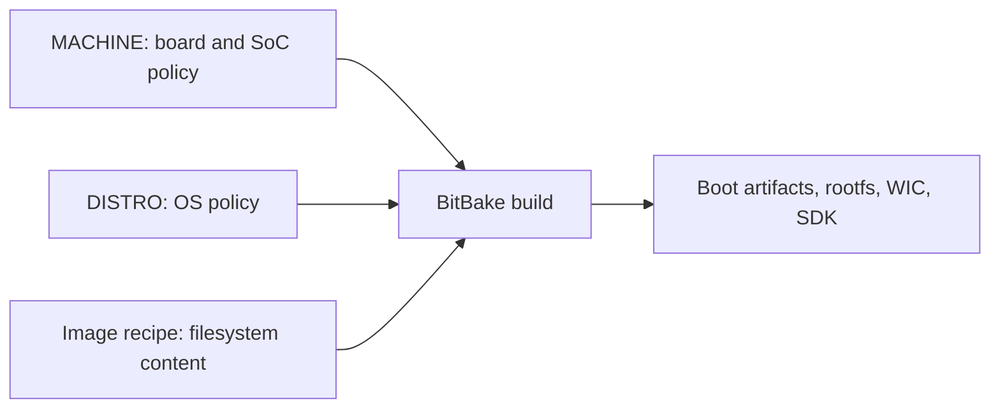

# Machines, Distros, and Image Targets

## Goal

Learn how `MACHINE`, `DISTRO`, and image recipes interact in TI SDK builds, and how to prove what each one selected. All output on this page comes from the reference build (`examples/build-systems/yocto/run.sh`: wrynose, meta-ti `wrynose`, `MACHINE = "am62xx-evm"`, `DISTRO = "poky"`).

## The Three Axes

Every TI SDK BitBake build has at least three selections:

- `MACHINE`: SoC and board support
- `DISTRO`: operating-system policy
- image target: root filesystem contents and deployable image formats



They are related but not interchangeable: a board difference is never solved in an image recipe, and a product feature is never added in a machine file.

## How An AM62x Machine Is Built Up

A TI machine file is short because most of its policy is in includes:

```text
am62xx-evm.conf                       board: device trees, A53 U-Boot defconfig
└─ include/am62xx.inc                 SoC: SOC_FAMILY, GPU, TF-A board, OP-TEE platform, consoles
   ├─ include/k3.inc                  K3 family: tune, KERNEL_IMAGETYPE, SPL names, IMAGE_BOOT_FILES, WIC, FIT signing
   │  ├─ include/ti-soc.inc
   │  └─ include/ti-bsp.inc           TI_PREFERRED_BSP -> kernel and U-Boot providers and versions
   └─ include/mc_k3r5.inc             BBMULTICONFIG += "k3r5"; images wait for the R5 bootloader

am62xx-evm-k3r5.conf                  R5 side: R5 U-Boot defconfig (used by the k3r5 multiconfig)
└─ include/k3r5.inc                   Armv7 tune, linux-dummy kernel, UBOOT_BINARY = tiboot3.bin
```

### What The Machine Selects: Real Values

```text
$ . ~/yocto/kb-am62xx-wrynose/build/init-build-env >/dev/null && for v in PREFERRED_PROVIDER_virtual/kernel PREFERRED_VERSION_linux-ti-staging PREFERRED_PROVIDER_virtual/bootloader PREFERRED_VERSION_u-boot-ti-staging TI_PREFERRED_BSP KERNEL_IMAGETYPE SPL_BINARY UBOOT_MACHINE; do printf '%-40s %s\n' $v "$(bitbake-getvar --quiet --value $v)"; done
PREFERRED_PROVIDER_virtual/kernel        linux-ti-staging
PREFERRED_VERSION_linux-ti-staging       6.18%
PREFERRED_PROVIDER_virtual/bootloader    u-boot-ti-staging
PREFERRED_VERSION_u-boot-ti-staging      2026.01%
TI_PREFERRED_BSP                         ti-6_18
KERNEL_IMAGETYPE                         Image
SPL_BINARY                               tispl.bin
UBOOT_MACHINE                            am62x_evm_a53_defconfig
```

Without `--value`, `bitbake-getvar` prints where a value was set. The kernel provider comes from `ti-bsp.inc`, through the `BSP_KERNEL_PROVIDER` indirection that `TI_PREFERRED_BSP` controls:

```text
$ . ~/yocto/kb-am62xx-wrynose/build/init-build-env >/dev/null && bitbake-getvar --quiet PREFERRED_PROVIDER_virtual/kernel
#
# $PREFERRED_PROVIDER_virtual/kernel
#   set? ~/yocto/kb-am62xx-wrynose/layers/meta-ti/meta-ti-bsp/conf/machine/include/ti-bsp.inc:101
#     "${BSP_KERNEL_PROVIDER}"
PREFERRED_PROVIDER_virtual/kernel="linux-ti-staging"
```

`set?` means a `?=` assignment: a default that a distro or product layer can override with a plain `=`.

`bitbake-layers show-recipes` lists every candidate and why the others are not used:

```text
$ . ~/yocto/kb-am62xx-wrynose/build/init-build-env >/dev/null && bitbake-layers show-recipes 'linux-ti-*' 'u-boot-ti-*' 2>&1 | grep -E '^[a-z]|^  meta'
linux-ti-mainline:
  meta-ti-bsp          git (skipped: PREFERRED_PROVIDER_virtual/kernel set to linux-ti-staging, not linux-ti-mainline)
linux-ti-next:
  meta-ti-bsp          git (skipped: PREFERRED_PROVIDER_virtual/kernel set to linux-ti-staging, not linux-ti-next)
linux-ti-staging:
  meta-ti-bsp          6.18.51+git
  meta-ti-bsp          6.12.57+git
  meta-ti-bsp          6.6.58+git
linux-ti-staging-rt:
  meta-ti-bsp          6.12 (skipped: PREFERRED_PROVIDER_virtual/kernel set to linux-ti-staging, not linux-ti-staging-rt)
  meta-ti-bsp          6.18 (skipped: PREFERRED_PROVIDER_virtual/kernel set to linux-ti-staging, not linux-ti-staging-rt)
  meta-ti-bsp          6.6 (skipped: PREFERRED_PROVIDER_virtual/kernel set to linux-ti-staging, not linux-ti-staging-rt)
u-boot-ti-mainline:
  meta-ti-bsp          git (skipped: PREFERRED_PROVIDER_virtual/bootloader set to u-boot-ti-staging, not u-boot-ti-mainline)
u-boot-ti-next:
  meta-ti-bsp          git (skipped: PREFERRED_PROVIDER_virtual/bootloader set to u-boot-ti-staging, not u-boot-ti-next)
u-boot-ti-staging:
  meta-ti-bsp          1:2026.01+git
  meta-ti-bsp          1:2025.01+git
  meta-ti-bsp          1:2024.04+git
```

Three versions of `linux-ti-staging` exist side by side; `PREFERRED_VERSION_linux-ti-staging = "6.18%"` picks one. The real-time kernel `linux-ti-staging-rt` is a separate provider: switching to it is a `PREFERRED_PROVIDER_virtual/kernel` change in your distro or machine, not a kernel configuration option.

### The Task Graph Crosses Into The k3r5 Multiconfig

`bitbake -g` writes the task graph without building anything. For the example product image:

```text
$ . ~/yocto/kb-am62xx-wrynose/build/init-build-env >/dev/null && bitbake -g kb-image 2>&1 | grep -E '^(NOTE: PN|ERROR)'; ls *.dot pn-buildlist
NOTE: PN build list saved to 'pn-buildlist'
pn-buildlist
task-depends.dot
$ grep -oE '"mc:k3r5:[a-z0-9.+-]+\.do_[a-z_]+"' task-depends.dot | sed 's/"//g; s/\.do_.*//' | sort -u | wc -l
126
$ grep -oE '"mc:k3r5:[a-z0-9.+-]+\.do_deploy"' task-depends.dot | sort -u
"mc:k3r5:ti-sci-fw.do_deploy"
"mc:k3r5:u-boot-ti-staging.do_deploy"
$ grep -E '"kb-image.do_image" -> "mc:k3r5' task-depends.dot
"kb-image.do_image" -> "mc:k3r5:u-boot-ti-staging.do_deploy"
```

One `bitbake kb-image` therefore builds 126 recipes in the R5 configuration (its own native tools, a bare-metal Armv7 toolchain, TIFS, and U-Boot) in addition to the Linux side. The single edge from `do_image` to the R5 U-Boot `do_deploy` comes from `mc_k3r5.inc`.

Inside the multiconfig, the same recipe sees different values. `bitbake-getvar` reads the default configuration, so query the R5 side with `bitbake -e mc:k3r5:<target>`:

```text
$ . ~/yocto/kb-am62xx-wrynose/build/init-build-env >/dev/null && bitbake -e mc:k3r5:virtual/bootloader 2>/dev/null | grep -E '^(PN|MACHINE|UBOOT_MACHINE|TCLIBC|TMPDIR|DEPLOY_DIR_IMAGE)='
DEPLOY_DIR_IMAGE="~/yocto/kb-am62xx-wrynose/build/deploy-ti/images/am62xx-evm"
MACHINE="am62xx-evm-k3r5"
PN="u-boot-ti-staging"
TCLIBC="baremetal"
TMPDIR="~/yocto/kb-am62xx-wrynose/build/tmp-k3r5"
UBOOT_MACHINE="am62x_evm_r5_defconfig"
```

Note `DEPLOY_DIR_IMAGE`: meta-ti deploys both configurations into `deploy-ti/images/<MACHINE>` (`TI_COMMON_DEPLOY`), not into `tmp/deploy`. Look for boot files there.

### A Product Machine Needs Its k3r5 Twin

The example layer contains a product machine pair, `kb-am62-board.conf` and `kb-am62-board-k3r5.conf` (shown in [Custom Sitara Board Bring-Up](custom-sitara-board-bring-up.md#custom-machine-two-files-on-k3)). Selecting the product machine with the R5 file temporarily removed:

```text
$ . ~/yocto/kb-am62xx-wrynose/build/init-build-env >/dev/null && bitbake-config-build enable-fragment machine/kb-am62-board >/dev/null 2>&1; bitbake-getvar --quiet --value MACHINE
kb-am62-board
$ . ~/yocto/kb-am62xx-wrynose/build/init-build-env >/dev/null && bitbake -p 2>&1 | sed -n '/sanity checker/,/is invalid/p'
ERROR:  OE-core's config sanity checker detected a potential misconfiguration.
    Either fix the cause of this error or at your own risk disable the checker (see sanity.conf).
    Following is the list of potential problems / advisories:

    MACHINE=kb-am62-board-k3r5 is invalid. Please set a valid MACHINE in your local.conf, environment or other configuration file.
```

The machine the error names is one you never typed: the `k3r5` multiconfig derived it. With both files present the parse succeeds, and the product machine inherits the SoC family from `am62xx.inc`:

```text
$ . ~/yocto/kb-am62xx-wrynose/build/init-build-env >/dev/null && bitbake -p 2>&1 | grep -E '^(Loaded|Parsing of|ERROR)'; bitbake-getvar --quiet --value SOC_FAMILY
Loaded 0 entries from dependency cache.
Parsing of 2188 .bb files complete (0 cached, 2188 parsed). 4306 targets, 366 skipped, 0 masked, 0 errors.
ti-soc:k3:am62xx
```

Changing `MACHINE` invalidated the whole parse cache (`0 cached, 2188 parsed`): machine-specific metadata can change any recipe. That is also why switching machines in one build directory is slow the first time.

`SOC_FAMILY` entries become machine overrides, so metadata written as `:am62xx` or `:k3` applies to the product board automatically.

## `DISTRO`

The distro controls package format, init system, libc, default features, preferred providers, security flags, license policy, and SDK behavior. TI's validated stack uses `arago`; see [TI Yocto and Arago Build Flow](ti-yocto-arago-build-flow.md#what-machine-distro-and-ti_preferred_bsp-select). The reference build uses `poky` to show that meta-ti-bsp works under any distro. Replacing Arago in a product is legitimate, but it is integration work: diff `DISTRO_FEATURES`, `INIT_MANAGER`, and preferred providers before and after.

## Image Targets

Image recipes control what goes into the root filesystem and which image files are produced. SDK 12.x provides `arago-base-image`, `arago-default-image`, `arago-tiny-image`, and the `arago-core-bundle` installer; SDK 11.x calls the same images `tisdk-*`. Read the image recipe and its package groups; do not judge an image by its name.

Inspect an image's composition:

```bash
bitbake-getvar --quiet -r arago-default-image --value IMAGE_INSTALL
bitbake-getvar --quiet -r arago-default-image --value IMAGE_FSTYPES
bitbake-getvar --quiet -r arago-default-image --value WKS_FILE
```

Only boot and WIC policy comes from the machine (`IMAGE_FSTYPES`, `IMAGE_BOOT_FILES`, and `WKS_FILE` are set in `k3.inc`); package selection comes from the image and its package groups.

## Custom Machine Strategy

A custom board gets its own machine pair in a product BSP layer, derived from the closest EVM, with:

- its own device tree list (`KERNEL_DEVICETREE`) and A53/R5 U-Boot defconfigs
- custom WIC layout only when storage changes
- product-owned firmware dependencies
- a written comparison against the EVM machine it came from

Board policy never lives in `local.conf`. See [Custom Sitara Board Bring-Up](custom-sitara-board-bring-up.md).

## Custom Image Strategy

A product has its own image recipes and package groups (production and development variants), with service enablement in those recipes. The example layer's `kb-image` and `packagegroup-kb-tools` are the minimal form. `IMAGE_INSTALL:append` in `local.conf` does not scale to CI, releases, or audits.

## Common Mistakes

- Using an EVM machine name for a product forever.
- Creating `myboard.conf` without `myboard-k3r5.conf`.
- Looking for boot files in `tmp/deploy/images` instead of `deploy-ti/images`.
- Querying R5 values with `bitbake-getvar` (it reads the A53 configuration).
- Putting board policy in an image recipe, or product applications in a machine file.
- Changing image content to solve a bootloader or kernel artifact issue.
- Assuming `arago-default-image` (or `tisdk-default-image`) is a production image.

## Related Topics

- [Machine and Distro Configuration](../yocto-openembedded/machine-and-distro-configuration.md)
- [Multiconfig and Firmware Builds](../yocto-openembedded/multiconfig-and-firmware-builds.md)
- [Boot Artifact Pipeline](boot-artifact-pipeline.md)
- [SDK Customization for Products](sdk-customization-for-products.md)
- [Custom Sitara Board Bring-Up](custom-sitara-board-bring-up.md)
