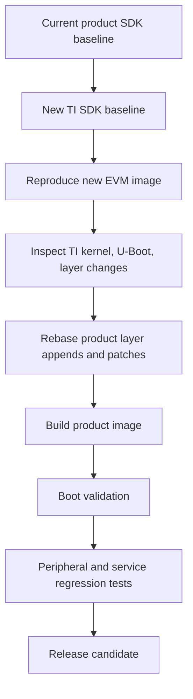

# Release Engineering and SDK Upgrades

## Goal

Make TI SDK based product builds reproducible, auditable, and upgradeable.

## What To Version

Version:

- TI SDK release
- layer revisions
- product layer revisions
- build configuration templates
- image target names
- machine names
- kernel and U-Boot providers
- firmware versions
- generated artifact checksums
- release manifests
- known deviations from TI baseline

Do not rely on "the build server has the right checkout".

## Manifest Strategy

A release should include:

- source manifest or repository lock file
- build configuration summary
- image manifest
- license manifest
- package list
- boot artifact checksums
- rootfs checksum
- WIC checksum
- SDK/toolchain checksum if produced
- build logs or CI links

## Upgrade Workflow

Never upgrade by blindly replacing layer directories. First reproduce the new vendor baseline, then reapply product-owned changes.

## Worked Upgrade: SDK 11.x (scarthgap) To SDK 12.x (wrynose)

An SDK major upgrade is also a Yocto LTS upgrade, so it changes both TI metadata and OE-Core conventions. Plan these items explicitly; each is a real difference between the two branches:

| Area | Change | What to do in product layers |
| --- | --- | --- |
| Build assembly | the `poky` repository ends at 5.2; wrynose uses `bitbake` + `openembedded-core` + `meta-yocto` | move the product manifest to separate repositories (TI's new `oe-layersetup` config, a `bitbake-setup` configuration, `kas`, or `repo`) |
| `LAYERSERIES_COMPAT` | layers must list `wrynose` | update every product `layer.conf`; a missing entry fails the parse |
| local sources | `file://` sources unpack into `${UNPACKDIR}`, not `${WORKDIR}` | replace `${WORKDIR}/foo.conf` with `${UNPACKDIR}/foo.conf` in `do_install`; set `S = "${UNPACKDIR}"` for file-only recipes |
| git sources | `S = "${WORKDIR}/git"` is now a fatal QA error; the default `S` is correct for git | delete those `S` lines |
| `SRCPV` | empty; when `PV` contains `+` (for example `1.0+git`), packaging appends the source revision to the package version automatically | drop `${SRCPV}` from `PV` |
| image names | `tisdk-*` → `arago-*` | update CI jobs, scripts, docs, and any `.bbappend` to TI images |
| kernel and U-Boot | default `TI_PREFERRED_BSP` moves from `ti-6_12` to `ti-6_18` (U-Boot 2025.01 → 2026.01) | rebase kernel/U-Boot patches and DTS changes; re-run config fragment audits ([Configuration Fragments and Auditing](../linux-kernel/configuration-fragments-and-auditing.md)) |
| firmware | new TIFS, DM, and remote-core firmware versions in `ti-linux-firmware` | rebuild and re-test both U-Boot configurations and all remote-core firmware together |
| distro | Arago `DISTRO_VERSION` 2025.01 → 2026.04, package and feature changes | diff `DISTRO_FEATURES`, `INIT_MANAGER`, and image manifests old vs new |

A practical order:

1. Reproduce the new SDK's EVM image with TI's release config, unmodified. Boot it.
2. Port product layers to compile: `LAYERSERIES_COMPAT`, `UNPACKDIR`, `S`, `SRCPV`, image names. The QA errors are explicit; [Debugging BitBake Builds](../yocto-openembedded/debugging-bitbake-builds.md) shows the real messages.
3. Rebase kernel and U-Boot patches onto the new `ti-6_18` trees. Drop patches that landed upstream.
4. Rebuild the product machine pair (`myboard.conf`, `myboard-k3r5.conf`) and boot to the U-Boot prompt before touching Linux.
5. Compare `buildhistory` image manifests and `bitbake-getvar` values of key variables between the old and new builds. Review every package that appeared, disappeared, or changed major version.
6. Run the full hardware test suite, including secure boot on HS-SE devices and remote-core firmware.

## Patch Ownership During Upgrades

Classify every product patch:

- already upstream in new SDK
- still required unchanged
- required but needs rework
- obsolete because hardware/software changed
- should be submitted upstream or to vendor

Do this for:

- kernel patches
- U-Boot patches
- DTS changes
- recipe appends
- package versions
- firmware changes

## CI Strategy

CI should at least:

- initialize layers from a pinned manifest
- use controlled `DL_DIR` and `SSTATE_DIR`
- build the product image
- build kernel and U-Boot explicitly when useful
- export deploy artifacts
- archive manifests and license output
- run static metadata checks
- run boot smoke tests when hardware is available

Hardware-in-the-loop tests are especially valuable for boot artifact changes.

## Reproducibility Notes

For reproducibility:

- pin source revisions
- mirror downloads
- control host environment
- record build container image or host package set
- avoid manual post-processing
- keep product changes in layers
- archive artifacts with checksums
- avoid time-dependent version strings unless deliberate

## Common Mistakes

- Updating TI layers without updating release documentation assumptions.
- Carrying patches forward without checking if they are obsolete.
- Treating successful compilation as a release candidate.
- Not archiving boot artifacts separately from rootfs artifacts.
- Releasing an image that cannot be traced to layer revisions.
- Making manual changes to a generated image after BitBake completes.

## Related Topics

- [CI, Hash Equivalence, and Shared State](../yocto-openembedded/ci-hash-equivalence-and-sstate.md)
- [Licensing, CVE, and SBOM Workflows](../yocto-openembedded/licensing-cve-and-sbom.md)
- [SDK Customization for Products](sdk-customization-for-products.md)
