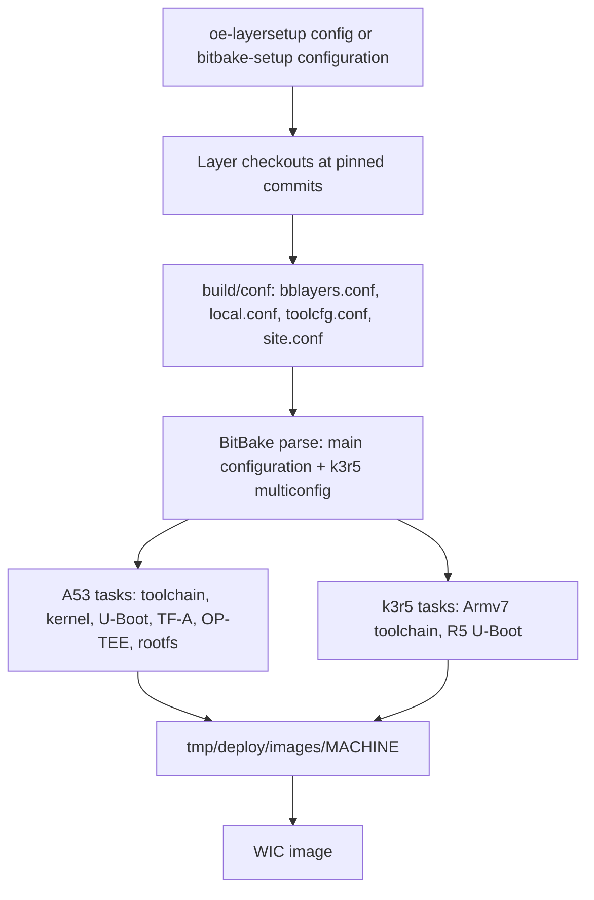

# TI Yocto and Arago Build Flow

## Goal

Know which repository and layer provides which part of a TI Processor SDK Linux build, how the layers depend on each other, and which TI-specific variables change the result. Facts on this page are from the `wrynose` branches (TI Processor SDK 12.x baseline). Differences for `scarthgap` (SDK 11.x) are listed in [Release Baseline](index.md#release-baseline).

## The Layer Stack

| Repository | Layer | Owns | Depends on |
| --- | --- | --- | --- |
| `openembedded-core` | `meta` (`core`) | toolchain, base recipes, classes, image machinery | — |
| `meta-arm` | `meta-arm`, `meta-arm-toolchain` | TF-A, OP-TEE, Arm toolchain recipes | `core` |
| `meta-ti` | `meta-ti-bsp` | TI machines, `linux-ti-*`, `u-boot-ti-*`, TI firmware, `k3r5` multiconfig | `core`, `meta-arm` |
| `meta-ti` | `meta-ti-extras` | TI user-space extras (IPC examples, firmware demos) | `meta-ti-bsp` |
| `meta-ti` | `meta-ti-test` | TI test recipes used by Arago test images | see its `layer.conf` |
| `meta-arago` | `meta-arago-distro` | the `arago` distro, `arago-*` images, `packagegroup-arago-*` | `meta-ti-bsp`, `meta-ti-extras`, `meta-ti-test`, meta-openembedded layers, `virtualization-layer`, `meta-arago-extras` |
| `meta-arago` | `meta-arago-extras` | extra recipes used by Arago images | various |
| `meta-openembedded` | `meta-oe`, `meta-networking`, `meta-multimedia`, `meta-python`, ... | community recipes Arago images need | `core` |
| `meta-virtualization` | `meta-virtualization` | container and virtualization recipes | `core` and others |

The dependencies come straight from each layer's `conf/layer.conf`:

```text
# meta-ti/meta-ti-bsp/conf/layer.conf
LAYERDEPENDS_meta-ti-bsp = " \
    core \
    meta-arm \
"

# meta-arago/meta-arago-distro/conf/layer.conf
LAYERDEPENDS_meta-arago-distro = " \
    core \
    meta-ti-bsp \
    meta-ti-extras \
    meta-ti-test \
    openembedded-layer \
    networking-layer \
    multimedia-layer \
    meta-python \
    virtualization-layer \
    meta-arago-extras \
"
```

The practical consequence: **`meta-ti-bsp` alone is light.** It needs only OE-Core and meta-arm, which is why a product can use TI hardware support with its own distro (this repository's reference build does exactly that: Poky distro, `meta-ti-bsp`, product layer). **The Arago distro is heavy**: it pulls in most of meta-openembedded and meta-virtualization. Use it to reproduce TI's SDK images, and decide deliberately whether your product inherits that policy.

BitBake enforces `LAYERDEPENDS` when you add a layer. Adding `meta-arm` before its own dependency fails like this (from `bitbake-layers add-layer` on the reference setup):

```text
ERROR: Layer 'meta-arm' depends on layer 'arm-toolchain', but this layer is not enabled in your configuration
ERROR: Parse failure with the specified layer added, exiting.
```

Add layers in dependency order: `meta-arm-toolchain`, `meta-arm`, `meta-ti-bsp`, then distro and product layers.

## Two Ways To Assemble The Layers

### TI's `oe-layersetup` (The SDK Workflow)

TI's Processor SDK documentation sets up the build with the `oe-layersetup` repository from `git.ti.com/arago-project/oe-layersetup`. A text config per SDK release lists every repository, branch, and commit:

```bash
git clone https://git.ti.com/git/arago-project/oe-layersetup.git tisdk
cd tisdk
./oe-layertool-setup.sh -f configs/processor-sdk/<release-config>.txt
cd build
. conf/setenv
MACHINE=am62xx-evm bitbake -k arago-default-image
```

Take `<release-config>` from the release notes of the exact SDK version you are reproducing. The config file *is* the release's layer manifest; keep a copy with your build records. `oe-layertool-setup.sh` clones the layers at the pinned commits and writes `conf/bblayers.conf`, `conf/local.conf`, and `conf/setenv`. BitBake then does the actual build.

### A Product Manifest With `bitbake-setup` (Yocto 6.0+)

From Yocto 5.3 on, the separate `poky` repository is no longer published; a build is assembled from `bitbake`, `openembedded-core`, and `meta-yocto` by **`bitbake-setup`**. It reads a JSON configuration that pins sources and lists layers and configuration fragments, so a product can own its manifest the same way TI owns its release config.

This repository's reference build uses one: `examples/build-systems/yocto/kb-wrynose.conf.json` ([explained here](../yocto-openembedded/build-directory-and-configuration.md#a-product-configuration-file)) pins bitbake, OE-Core, meta-yocto, meta-arm, and meta-ti, and adds the product layer by a path relative to the file. One command creates the whole setup:

```sh
bitbake-setup init --non-interactive ~/AI-knowledge-base/examples/build-systems/yocto/kb-wrynose.conf.json am62xx-evm
```

See [Build Directory and Configuration](../yocto-openembedded/build-directory-and-configuration.md) for the generated files.

| Question | `oe-layersetup` config | `bitbake-setup` configuration |
| --- | --- | --- |
| Who owns it | TI, per SDK release | you, per product release |
| Format | text, one line per repository | JSON: sources, layers, fragments |
| Pins commits | yes | yes (`rev`), and records the result in `config/sources-fixed-revisions.json` |
| Selects `MACHINE`/`DISTRO` | `conf/setenv`, `local.conf` | `oe-fragments` (`machine/...`, `distro/...`) |
| Good for | reproducing the EVM baseline | product CI and long-term maintenance |

A common product path: reproduce the SDK baseline with TI's config, then copy its commit pins into a product `bitbake-setup` configuration (or a `kas` file, or a `repo` manifest), and add product layers.

## What `MACHINE`, `DISTRO`, And `TI_PREFERRED_BSP` Select

- `MACHINE` selects SoC and board support: tune (`cortexa53`), device trees, U-Boot defconfigs for both cores, firmware, WIC layout, serial consoles. On K3 it also enables the `k3r5` multiconfig. See [Machines, Distros, and Image Targets](machines-distros-and-image-targets.md).
- `DISTRO` selects OS policy. `arago` sets `INIT_MANAGER` to systemd (`ARAGO_SYSVINIT = "1"` switches to sysvinit), adds distro features such as `opencl`, configures package preferences and security flags, and sets `DISTRO_VERSION` (`2026.04` on wrynose, `2025.01` on scarthgap).
- `TI_PREFERRED_BSP` (from `meta-ti-bsp`) selects which kernel and U-Boot families are used: `ti-6_18` (default on wrynose), `ti-6_12`, `ti-6_6`, `mainline`, or `next`. It also adds a `bsp-<name>` machine override, so metadata can say `SRC_URI:append:bsp-mainline = ...`.
- `ARAGO_BRAND` (from `meta-arago-distro`) selects a branding include: `core` (default), `mainline` and `ltsprep` (set `TI_PREFERRED_BSP`), and `bleeding` and `next`, which set `SRCREV = "${AUTOREV}"` for the kernel, U-Boot, TF-A, and firmware. **Never build a release with `bleeding` or `next`**: the sources change with every build.

## Image Targets Were Renamed

The SDK images are named after the distro on wrynose and after the SDK on scarthgap:

| Purpose | scarthgap (SDK 11.x) | wrynose (SDK 12.x) |
| --- | --- | --- |
| initramfs-sized test image | `tisdk-base-image` | `arago-base-image` |
| full SDK demonstration filesystem | `tisdk-default-image` | `arago-default-image` |
| minimal boot | `tisdk-tiny-image` | `arago-tiny-image` |
| host installer bundle | `tisdk-core-bundle` | `arago-core-bundle` |

Scripts, CI jobs, and documentation that hard-code `tisdk-*` names break on upgrade. `arago-default-image` installs test tools (`ti-test`), graphics, multimedia, connectivity, crypto, and add-on package groups, plus package management: a development and demonstration image, not a production one. Build your own image recipe for products ([Images and Package Groups](../yocto-openembedded/images-and-packagegroups.md)).

## Build Flow



## Inspecting The Active Build

```bash
bitbake-layers show-layers
bitbake-layers show-appends
bitbake-getvar --quiet PREFERRED_PROVIDER_virtual/kernel
bitbake-getvar --quiet --value TI_PREFERRED_BSP
bitbake-getvar --quiet --value BBMULTICONFIG
bitbake -g arago-default-image && grep -c '"mc:k3r5:' task-depends.dot
```

`bitbake-getvar` without `--value` prints the full history of a variable: every file and line that set or changed it. That answers "why is this the value?" faster than reading layers by hand. Real output from the reference build is on [Machines, Distros, and Image Targets](machines-distros-and-image-targets.md).

## Where Product Layers Fit

```text
openembedded-core, meta-arm, meta-ti-bsp      (vendor and community input, never edited)
meta-arago-* and meta-openembedded            (optional: TI's distro policy)
meta-company-bsp      product machines (both myboard.conf and myboard-k3r5.conf), DTS, U-Boot and kernel deltas
meta-company-distro   product distro: init, features, security, package policy
meta-company-apps     product applications, package groups, product image recipes
```

Layer priority should be deliberate, and it is never a substitute for understanding provider selection. TI layers use priority 6 (`meta-ti-bsp`) and 10 (`meta-arago-*`).

## Common Mistakes

- Mixing documentation from one SDK release with layer revisions from another.
- Treating the `oe-layersetup` checkout as an editable workspace with no patch plan.
- Assuming the Arago distro is required for TI hardware support; it is not.
- Building with `ARAGO_BRAND = "bleeding"` or `AUTOREV` and calling the result a release.
- Using `tisdk-*` image names on wrynose, or `arago-*` names on scarthgap.
- Changing `MACHINE` and assuming only the DTB changes (it also changes both U-Boot defconfigs, firmware, tuning, and the R5 machine).
- Adding packages in `local.conf` instead of owning image policy in a layer.

## Related Topics

- [Processor SDK Build System vs TI Yocto Layers](sdk-build-system-vs-ti-yocto-layers.md)
- [Boot Artifact Pipeline](boot-artifact-pipeline.md)
- [Machines, Distros, and Image Targets](machines-distros-and-image-targets.md)
- [Yocto and OpenEmbedded](../yocto-openembedded/index.md)

## References

- [meta-ti](https://git.yoctoproject.org/meta-ti/) and [meta-arago](https://git.yoctoproject.org/meta-arago/) (Yocto Project mirrors of TI's layers)
- [TI oe-layersetup](https://git.ti.com/cgit/arago-project/oe-layersetup/)
- [Yocto Project: bitbake-setup](https://docs.yoctoproject.org/bitbake/dev/bitbake-user-manual/bitbake-user-manual-environment-setup.html)
- TI Processor SDK Linux release notes for the selected version
