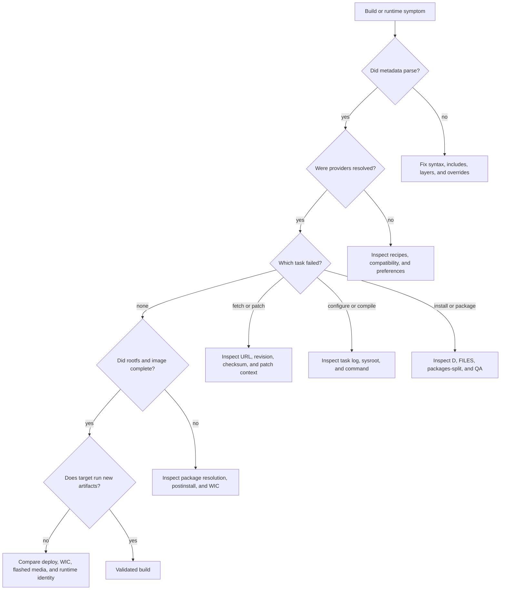

# Debugging BitBake Builds

## What Problem Does This Solve?

BitBake failures can occur during parsing, provider selection, fetching, patching, configuration, compilation, installation, packaging, rootfs construction, image generation, deployment, or target boot. Efficient debugging starts by identifying the layer and task that failed.

## Core Concepts

- parse error
- provider selection
- expanded environment
- task log
- generated run script
- dependency graph
- signature
- package data
- rootfs failure
- deployment mismatch

## Debugging Mental Model

```text
classify failure
-> inspect final metadata
-> inspect exact task log/run script
-> inspect task inputs/workdir
-> fix maintained metadata/source
-> rebuild minimum scope
-> validate full image/runtime
```

## Failure-Mode Matrix



| Symptom | Layer | First Checks |
| --- | --- | --- |
| metadata syntax error | parsing | file/line, override syntax, include path |
| nothing provides item | providers | recipe availability, layer, `PROVIDES`, preferences |
| append not applied | layers | filename matching, active layer, selected recipe version |
| fetch fails | source | URL, revision, branch, credentials, mirrors, checksums |
| patch fails | source/patch | patch order, source revision, `${S}`, patch context |
| configure fails | build system | sysroot, dependencies, cross detection, feature options |
| compile fails | source/build | first compiler error, command, headers/libs, host contamination |
| install fails | recipe | `${D}`, paths, permissions, parallel races |
| QA/package fails | packaging | `FILES`, dependencies, RPATH, ownership, unshipped files |
| rootfs fails | image/package | package name, architecture, conflicts, postinstall |
| image builds but board unchanged | deployment | deploy/WIC checksums, boot source, flashed media |

## Parse Failures

Parse errors happen before any task runs, so no task log exists. The message names the file. Real examples from the reference build (`examples/build-systems/yocto/run.sh`):

A `file://` entry that is not in any `FILESPATH` directory. The list of searched paths is the most useful part: it shows every override directory BitBake tried, which is exactly where a machine- or distro-specific copy may live:

```text
$ . ~/yocto/kb-am62xx-wrynose/build/init-build-env >/dev/null && bitbake -p 2>&1 | grep -E 'ERROR|searched|kb-qa-missing/' | sed 's/^Parsing recipes\.\.\.//' | head -n 4
ERROR: ~/AI-knowledge-base/examples/build-systems/yocto/meta-kb-example/recipes-qa/kb-qa-demo/kb-qa-missing_1.0.bb: Unable to get checksum for kb-qa-missing SRC_URI entry not-in-the-layer.conf: file could not be found
The following paths were searched:
~/AI-knowledge-base/examples/build-systems/yocto/meta-kb-example/recipes-qa/kb-qa-demo/kb-qa-missing/poky/not-in-the-layer.conf
```

The full list continues with one directory per active override (`am62xx-evm`, `am62xx`, `k3`, `ti-soc`, ...). With a multiconfig, the same recipe is parsed once per configuration, so the error can also be reported for the `k3r5` side, with `am62xx-evm-k3r5` in the paths.

A recipe written for scarthgap, where `file://` sources unpacked into `WORKDIR`:

```text
$ . ~/yocto/kb-am62xx-wrynose/build/init-build-env >/dev/null && bitbake -p 2>&1 | grep -E '^ERROR' | head -n 1
ERROR: ~/AI-knowledge-base/examples/build-systems/yocto/meta-kb-example/recipes-qa/kb-qa-demo/kb-qa-legacy-workdir_1.0.bb: Using S = ${WORKDIR} is no longer supported
```

One broken recipe stops the parse for the whole build, including unrelated targets. Other parse-time failures: a layer added before its `LAYERDEPENDS` ([Layers](layers.md#layer-dependencies)), an incompatible `LAYERSERIES_COMPAT`, an invalid `MACHINE` (on TI K3, also the derived `-k3r5` machine), obsolete override syntax (`_append` instead of `:append`), a missing `require` target, and Python errors in inline `${@...}` expressions.

Not every legacy setting fails at parse time. `S = "${WORKDIR}/git"` parses, and fails when the source is unpacked:

```text
$ . ~/yocto/kb-am62xx-wrynose/build/init-build-env >/dev/null && bitbake kb-qa-legacy-git -c unpack 2>&1 | grep -E '^ERROR' | head -n 1
ERROR: kb-qa-legacy-git-1.0-r0 do_unpack: Recipes that set S = "${WORKDIR}/git" or S = "${UNPACKDIR}/git" should remove that assignment, as S set by bitbake.conf in oe-core now works.
```

Useful commands:

```sh
bitbake -p                     # parse only; fastest way to check metadata after an edit
bitbake-layers show-layers
bitbake-layers show-appends <recipe>
```

## Inspecting Final Metadata

`bitbake-getvar` prints one variable after all files, overrides, and appends are applied, with the history of every operation that touched it:

```sh
bitbake-getvar MACHINE                     # global value, with history
bitbake-getvar -r <recipe> SRC_URI         # value inside one recipe
bitbake-getvar -r <recipe> --value S       # value only, for scripts
bitbake-getvar -r <recipe> -f vardeps --value do_compile   # a variable flag
```

The history answers "who set this?" directly; see the `S` example in [Tasks and Workdirs](tasks-and-workdirs.md#workdir-path) and the `MACHINE` example in [Build Directory and Configuration](build-directory-and-configuration.md#bblayersconf-and-fragments). `bitbake -e <recipe>` still prints the entire datastore (tens of thousands of lines) and is useful for searching when you do not know the variable name.

`bitbake-getvar` reads the default configuration. For a multiconfig use `bitbake -e mc:<name>:<target>`.

## Provider Debugging

```sh
bitbake-layers show-recipes '<pattern>'
bitbake-getvar PREFERRED_PROVIDER_virtual/kernel
bitbake-getvar --value PREFERRED_VERSION_<recipe>
```

`show-recipes` prints every candidate and, for skipped ones, the reason, for example `skipped: PREFERRED_PROVIDER_virtual/kernel set to linux-ti-staging, not linux-ti-mainline` (full output in [Machines, Distros, and Image Targets](../ti-processor-sdk/machines-distros-and-image-targets.md#what-the-machine-selects-real-values)).

Questions:

- is the provider's layer active?
- is the recipe compatible with the machine (`COMPATIBLE_MACHINE`)?
- is the version masked or not preferred?
- is a preference scoped to the wrong override?
- does the provider actually declare the capability (`PROVIDES`)?

## Fetch Failures

Read `log.do_fetch`.

Check:

- URL/protocol
- branch name
- fixed revision exists
- private credentials/SSH setup
- checksum
- proxy/mirror policy
- network isolation

Do not solve a missing revision by switching release builds to a floating branch head.

## Patch Failures

```sh
bitbake -c patch <recipe>
bitbake -e <recipe> | grep '^S='
```

Inspect:

- source revision
- patch ordering in `SRC_URI`
- path strip level
- whether vendor already applied equivalent change
- whether patch modifies generated files

Rebase patches as clean commits against the selected source.

## Configure Failures

Check:

- `log.do_configure`
- configure cache/results
- `${S}` and `${B}`
- recipe sysroot
- `DEPENDS`
- `PACKAGECONFIG`
- cross-compilation detection

Common issue: upstream project runs a target binary during configure. It needs a cross-aware check or native helper strategy.

## Compile Failures

Start with the first real compiler/linker error, not the last cascade.

Check generated command in log/run script:

- compiler target
- `--sysroot`
- include paths
- library paths
- generated headers
- parallel race
- warning-as-error behavior

Use `bitbake -c devshell <recipe>` for focused reproduction.

## Install And Packaging Failures

Inspect `${D}`:

```sh
bitbake -e <recipe> | grep '^D='
```

Check:

- files installed to target paths
- no host absolute paths
- correct modes/owners
- `FILES` assignments
- empty/missing package
- runtime dependencies
- RPATH and stripped/debug behavior

`installed-vs-shipped` QA means a file exists in `${D}` but no output package owns it.

## Rootfs Failures

Read image `log.do_rootfs`.

Check:

- requested package exists
- package architecture compatible
- dependency conflicts
- provider alternatives
- package feed metadata
- post-install scripts
- read-only-rootfs constraints

Use the image manifest from successful builds to compare composition.

## Dependency Graphs

```sh
bitbake -g <target>
```

Current BitBake writes `task-depends.dot` (every task and edge) and `pn-buildlist` (every recipe in the build). Filter them with `grep`; they are far too large to render. Example questions:

- why is a recipe being built? `grep '"<target>.do_' task-depends.dot | grep '<recipe>'`
- what crosses into a multiconfig? `grep -o '"mc:<name>:[^"]*"' task-depends.dot`

The real TI example is in [Machines, Distros, and Image Targets](../ti-processor-sdk/machines-distros-and-image-targets.md#the-task-graph-crosses-into-the-k3r5-multiconfig).

## Signature Debugging

Every task has a signature (hash) computed from the variables and functions it uses and the signatures of the tasks it depends on. A task reruns when its signature changes; it is restored from shared state when a matching signature exists. To ask *why* a task reran, compare its last two signatures:

```text
$ . ~/yocto/kb-am62xx-wrynose/build/init-build-env >/dev/null && bitbake-diffsigs -t board-tool do_compile 2>&1 | head -n 12
Hash for task dependency board-tool:do_configure changed from 1b9722a9aa54dec47d69647d7414fa49ce0c469d5ad1750a283064d83ad4ddf7 to 79a292ee19e34ce9911fbc324ea3d68cd76ca395774f9485ad18fb1c2db9017b
    basehash changed from e7307533d1853e9d7aa03f608cea665d8fb24aec20566ce5658578bf8b4ec91f to a12ca07af70bfeef2eb9aecfa6df877960abf065658f26f5959540fd52bc05da
    Variable EXTRA_OEMAKE value changed:
    "VERSION=${PV} {+CFLAGS=-Os+}"
```

The session had added `EXTRA_OEMAKE += "CFLAGS=-Os"` through a temporary `.bbappend`. `bitbake-diffsigs` walks back to the first task whose own inputs changed (`do_configure`) and prints the variable diff (`{+...+}` added, `[-...-]` removed). `bitbake-dumpsig -t <recipe> <task>` prints everything one signature contains.

When the append was removed again, only one task reran:

```text
$ . ~/yocto/kb-am62xx-wrynose/build/init-build-env >/dev/null && bitbake board-tool 2>&1 | grep -E '^(Sstate summary|NOTE: Tasks Summary)'
NOTE: Tasks Summary: Attempted 933 tasks of which 932 didn't need to be rerun and all succeeded.
```

The signatures were back to values whose output was already in shared state, so it was restored instead of rebuilt. Unexpected cache misses are diagnosed the same way: `bitbake-diffsigs` between the expected and actual signature names the variable that leaked into the hash (a timestamp, a host path, a changing `SRCREV`). Do not exclude variables from signatures (`vardepsexclude`) merely to improve cache hits unless they truly cannot affect output.

## Debugging Package Inclusion

If a file or package is missing from the image, walk the chain from file to image:

```sh
oe-pkgdata-util find-path /usr/bin/board-tool      # which package ships this file?
oe-pkgdata-util lookup-recipe board-tool           # which recipe makes this package?
oe-pkgdata-util list-pkgs -p board-tool            # all packages of a recipe
oe-pkgdata-util list-pkg-files board-tool          # files in one package
oe-pkgdata-util read-value RDEPENDS board-tool     # runtime dependencies, including automatic ones
```

Real output for the example recipe is in [Packaging, QA, and Package Feeds](packaging-qa-and-feeds.md#shared-library-dependencies). Then check whether the image or a package group requests that package (`bitbake-getvar -r <image> --value IMAGE_INSTALL`), and compare the image manifest or `buildhistory/images/.../installed-package-names.txt` with what you expect. Do not search only for the recipe name: images install packages, not recipes.

## Deployment Debugging

Build success is not runtime proof.

Compare:

- versioned deploy files
- symlink targets
- WIC contents
- flashed media checksums
- U-Boot serial version/environment
- kernel `uname -a`
- runtime DTB
- rootfs release manifest

## Logging A Reproducible Failure

Capture:

- target command
- machine/distro
- layer revisions
- selected provider/version
- failing task
- full task log
- relevant `bitbake -e` variables
- source revision
- whether sstate/mirrors were used

## Cleaning Strategy

Prefer minimal scope:

1. Fix metadata/source.
2. Let signatures rerun tasks.
3. Force one task only for diagnosis.
4. Use `clean` if workdir state is suspect.
5. Use `cleansstate` when task output must be rebuilt.
6. Use `cleanall` only when downloads themselves must be removed.

## Worked Example: Nothing Provides A Package

Rootfs reports:

```text
nothing provides product-agent-cli
```

Check:

```sh
bitbake-layers show-recipes product-agent
bitbake -e product-agent | grep '^PACKAGES='
```

If package is actually named `product-agent-tools`, fix image/package-group package name. Do not rename the recipe blindly.

## Worked Example: Host Header Contamination

Compile log contains `/usr/include/...` before recipe sysroot paths.

Investigate upstream build commands and class/toolchain integration. Fix the build system to honor supplied compiler/sysroot; do not add the host package as an undocumented build prerequisite.

## Worked Example: Why Did A Recipe Build?

```sh
bitbake -g product-image
grep -E '"product-image\.do_[a-z_]+" -> "product-recipe\.' task-depends.dot
grep -E -e '-> "product-recipe\.do_' task-depends.dot | cut -d' ' -f1 | sort -u
```

The second command lists every task that pulls `product-recipe` in. Follow the chain back to the package group or dependency that owns it, then correct that, rather than masking the recipe.

## Common Mistakes

- Deleting all caches before reading logs.
- Debugging recipe text instead of final expanded metadata.
- Fixing task order instead of declaring dependency.
- Ignoring workspace-layer overrides.
- Treating package and recipe names as identical.
- Stopping after image build without verifying deployed runtime.
- Reporting only the last line of a task failure.

## Master Checklist

- Parse, provider, task, package, image, or deployment failure?
- Which exact recipe/provider/version?
- Which task failed?
- What is `${WORKDIR}`?
- What does first error in task log say?
- What generated command ran?
- What are final relevant variables?
- Are dependencies correctly modeled?
- Is sstate involved?
- Does maintained metadata contain the fix?
- Does a clean image/runtime validate it?

## Related Topics

- [Tasks and Workdirs](tasks-and-workdirs.md)
- [Recipes](recipes.md)
- [Layers](layers.md)
- [Reproducibility, Caches, and Mirrors](reproducibility-caches-and-mirrors.md)

## References

- BitBake User Manual
- Yocto Project Reference Manual
- Yocto Project Development Tasks Manual
