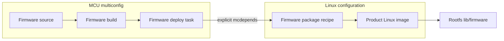

# Multiconfig and Firmware Builds

## What Problem Does This Solve?

Modern SoCs can run Linux on application cores while auxiliary cores run separate firmware built with different compilers, machines, distributions, or metadata. BitBake multiconfig models these as separate build configurations with explicit cross-configuration dependencies.

## Core Concepts

- multiconfig
- `BBMULTICONFIG`
- `conf/multiconfig/*.conf`
- cross-config dependency
- `mcdepends`
- artifact handoff
- auxiliary-core firmware
- remoteproc
- PRU/R5/M4 firmware
- deployment ownership

## Mental Model

```text
Linux configuration
  machine, toolchain, image, rootfs

firmware configuration
  auxiliary-core target, compiler, firmware recipe

explicit cross-config dependency
-> Linux image/package consumes firmware artifact
```

Multiconfig prevents hidden manual copying between unrelated build trees.



## Configuration Files

A multiconfig is enabled by name and defined by a file of the same name in any layer's `conf/multiconfig/` directory:

```bitbake
BBMULTICONFIG += "mcu"
```

```text
conf/multiconfig/mcu.conf
```

The file is parsed **on top of** the normal configuration, so it only states what differs: usually `MACHINE`, often `TMPDIR` (so the two configurations do not share a work tree), sometimes `DISTRO` or `TCLIBC`.

## Real Example: TI K3 `k3r5`

Every TI K3 machine in meta-ti uses a multiconfig to build the 32-bit R5 bootloader next to the 64-bit Linux build. It is the clearest production example of the mechanism (meta-ti `wrynose`):

```text
# meta-ti-bsp/conf/machine/include/mc_k3r5.inc  (required by am62xx.inc and the other K3 SoC includes)
BBMULTICONFIG += "k3r5"

do_image[mcdepends] += "mc::k3r5:virtual/bootloader:do_deploy"
```

```text
# meta-ti-bsp/conf/multiconfig/k3r5.conf
MAINMACHINE := "${MACHINE}"

DEPLOY_DIR_IMAGE:k3r5 = "${TI_COMMON_DEPLOY}/images/${MAINMACHINE}"

MACHINE:append = "-k3r5"
TCLIBC = "baremetal"
TI_TMPDIR_APPEND ?= "-k3r5"
TMPDIR:append = "${TI_TMPDIR_APPEND}"
```

Each line teaches one rule:

- **Enable from the machine, not from `local.conf`.** Putting `BBMULTICONFIG` in the SoC include means every build for that SoC gets it automatically.
- **Derive, do not duplicate.** `MAINMACHINE := "${MACHINE}"` captures the main machine with immediate expansion *before* `MACHINE:append` changes it, and `MACHINE:append = "-k3r5"` derives the R5 machine name. A product board `myboard` therefore needs a `myboard-k3r5.conf`.
- **Separate work trees.** `TMPDIR:append` gives the R5 configuration its own `tmp-k3r5`; its toolchain (`TCLIBC = "baremetal"`, Armv7 tune) never mixes with the AArch64 one.
- **Shared hand-off point.** Both configurations deploy into the same images directory, so the image and WIC steps find `tiboot3.bin` next to `tispl.bin`.
- **Declare the cross-config edge.** `do_image` of every image waits for the R5 bootloader's `do_deploy`.

The proof that the edge is in the task graph is in [Machines, Distros, and Image Targets](../ti-processor-sdk/machines-distros-and-image-targets.md#the-task-graph-crosses-into-the-k3r5-multiconfig) (`bitbake -g` output from the reference build).

## Building A Multiconfig Target

```sh
bitbake mc:k3r5:virtual/bootloader               # only the R5 bootloader
bitbake virtual/bootloader mc:k3r5:virtual/bootloader   # both U-Boot builds
bitbake mc::kb-image                             # "mc::" = the default configuration, same as kb-image
```

Query a variable inside a multiconfig with `bitbake -e mc:k3r5:<recipe>`; `bitbake-getvar` reads the default configuration.

## Cross-Config Dependency

The syntax has **two** configuration fields, the depending one and the depended-on one:

```text
<task>[mcdepends] += "mc:<from-config>:<to-config>:<recipe>:<task>"
```

An empty `<from-config>` means the default configuration, which is why meta-ti writes `mc::k3r5:...`. For a hypothetical MCU firmware consumed by a Linux recipe:

```bitbake
do_install[mcdepends] += "mc::mcu:product-firmware:do_deploy"
```

The dependency only orders tasks; it does not copy anything. The consumer must read the producer's output from an agreed location (here, the shared deploy directory). Use the exact task relationship needed; do not add broad dependencies that serialize whole builds.

## Worked Example: Firmware Package For Linux Rootfs

Goal:

- build auxiliary firmware in `mcu` config
- deploy deterministic binary
- package it into Linux rootfs under `/lib/firmware/product/`

Firmware config produces:

```text
product-r5f-fw.bin
```

Linux-side packaging recipe declares a cross-config dependency on firmware deploy and installs the artifact into `${D}${nonarch_base_libdir}/firmware/product/`.

Conceptual dependency:

```bitbake
do_install[mcdepends] += "mc::mcu:product-firmware:do_deploy"
```

Conceptual install:

```bitbake
do_install() {
    install -d ${D}${nonarch_base_libdir}/firmware/product
    install -m 0644 ${FIRMWARE_DEPLOY_DIR}/product-r5f-fw.bin \
        ${D}${nonarch_base_libdir}/firmware/product/
}
```

The actual cross-config artifact path should be exposed through deliberate metadata/class interfaces, not guessed from another `tmp` directory.

## Artifact Handoff Design

Good handoff:

- explicit dependency
- stable artifact name
- checksum/version metadata
- deterministic deploy task
- package ownership
- no developer absolute paths

Bad handoff:

- shell script copies from another build after BitBake finishes
- recipe scans arbitrary sibling directories
- image depends on whichever firmware file was built last

## Firmware Versioning

Record firmware identity in:

- filename or manifest
- package version
- build metadata
- runtime logs/API if supported

Linux driver, device tree, and firmware ABI must remain compatible.

## Remoteproc Integration

For Linux-loaded firmware, align:

- firmware package path/name
- device tree `firmware-name` or driver expectations
- remoteproc driver config
- memory carveouts
- resource table
- boot/start policy

An image can contain firmware successfully while runtime loading fails due to DT/ABI/memory mismatch.

## TI SoC Examples

TI devices can include PRU, R5F, M4F, DSP, or other cores depending on SoC.

Potential build sources:

- TI firmware packages
- external MCU+ SDK builds
- product firmware recipes
- prebuilt signed firmware

For each core document:

- producer/toolchain
- artifact filename
- package/install path
- consumer driver
- device tree node
- signing/security requirements
- release version compatibility

## When Not To Use Multiconfig

Do not add multiconfig merely because there are multiple recipes.

Normal recipes are sufficient when all components share the same configuration context and toolchain model.

Use multiconfig when separate configurations are genuinely needed.

## Debugging Cross-Config Builds

Check:

- `BBMULTICONFIG` includes expected name
- config file is found
- target syntax is correct
- cross-config task dependency is correct
- deploy artifact exists
- consumer task reruns when firmware changes
- signatures include artifact/version inputs

## Worked Runtime Verification

On target:

```sh
find /lib/firmware -name '*product*' -type f
dmesg | grep -i remoteproc
```

Where platform interfaces expose state, check firmware version and remote processor status. Preserve Linux and firmware logs together.

## Common Mistakes

- Copying firmware manually between build directories.
- Depending on a directory rather than a producing task.
- Failing to rerun Linux package/image when firmware changes.
- Installing firmware under wrong runtime filename.
- Ignoring firmware/driver/device-tree ABI.
- Using multiconfig when a normal recipe dependency suffices.
- Releasing firmware without toolchain/source provenance.

## Debugging Checklist

- Why is a separate configuration required?
- Which config builds firmware?
- Which task deploys it?
- Which Linux-side task consumes it?
- Is dependency explicit and signature-aware?
- Which package owns firmware?
- Does image manifest include package?
- Does runtime driver request exact filename?
- Are DT memory/remoteproc settings compatible?

## Related Topics

- [Machine and Distro Configuration](machine-and-distro-configuration.md)
- [Kernel Recipe Internals](kernel-recipe-internals.md)
- [CI, Hash Equivalence, and Shared State](ci-hash-equivalence-and-sstate.md)
- [TI Processor SDK Linux](../ti-processor-sdk/index.md)

## References

- BitBake multiconfig documentation
- Yocto Project Reference Manual
- Linux remoteproc documentation
